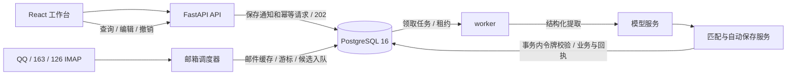

# Job Application Agent

A personal recruiting inbox that turns notifications into application records and actionable tasks.

把招聘邮件和粘贴的通知转成申请进度与待办。支持 QQ / 网易邮箱、AI 字段提取、自动匹配保存，以及事后编辑和撤销。

这是一个个人空间的 AI 应用与工程实践项目，包含 React 工作台、FastAPI 后端、PostgreSQL 持久任务队列、独立 worker 和邮箱调度器。项目由维护者与 AI 协作逐步实现，选择性复用的上游基础代码及许可证见 [NOTICE.md](NOTICE.md)。

## 能做什么

| 使用场景 | 当前行为 |
| --- | --- |
| 粘贴招聘通知 | 提取公司、岗位、招聘类别、通知类型、日期和原文证据，匹配后自动保存 |
| 信息不完整 | 岗位可留空、仅日期可记录；真正歧义保留待整理，不循环要求确认 |
| 邮箱导入 | QQ / 163 / 126，使用 IMAP 授权码；默认每12小时读取，首次回溯60天，筛选招聘候选 |
| 查看与纠错 | 申请、事项、事件和处理记录；主动编辑、版本冲突检查、撤销时保护后续手动修改 |
| 后台处理 | 202入队、请求回放、租约接管、有限重试、取消、连接预算与队列背压 |
| 运维 | 就绪/存活检查、进程心跳、任务追踪、告警状态、日志轮转、独立新库备份恢复 |

不自动投递或发送邮件。当前面向个人使用，没有开放多用户注册；公网 TLS、远程部署和托管服务尚未交付。

## 快速启动

需要 Docker Engine / Docker Desktop 与 Compose v2。第一次构建需要获取基础镜像和依赖。

```bash
git clone https://github.com/Fangch-JKbai/job-application-agent.git
cd job-application-agent
docker build -t job-application-agent:local .
docker run --rm --user "$(id -u):$(id -g)" \
  -v "$PWD:/workspace" -w /workspace --entrypoint /app/.venv/bin/python \
  job-application-agent:local scripts/configure_delivery.py --container
bash scripts/delivery.sh up
```

打开 <http://127.0.0.1:8001/>，用本机 `.env` 中的 `APP_ACCESS_TOKEN` 登录。初始化脚本随机生成口令、会话密钥和邮箱加密密钥，不输出这些值。完整启动、停止、更新与资源配置见[部署说明](docs/deployment.md)。以上 shell 示例适用于 macOS / Linux，Windows 可在 WSL2 中运行。

未配置模型凭据时可使用手动申请管理。要开启 AI 识别，在 `.env` 设置自己的 `LLM_PROVIDER`、对应的 API key、模型名和兼容接口地址，再重建服务：

```bash
bash scripts/delivery.sh up
```

默认供应商配置为 DeepSeek；模型名和可用性取决于你的账户，请自行填写。通知内容会发送给所配置的模型供应商。邮箱在工作台中绑定，使用 IMAP 授权码；邮箱解密密钥必须保留原值，备份方式见[恢复说明](docs/backup-restore.md)。不要提交 `.env` 或真实邮件。

## 架构



工程决策、数据流和模块入口见[架构说明](docs/architecture.md)。

## 验证状态

截至2026-10-29，独立新目录构建和本地四服务验收覆盖20项发布检查；另有46项可靠性、11项升级、31项观测和25项自动保存回归。发布检查使用合成数据、预置提取或明确模型/邮箱替身；不代表真实模型准确率或生产容量。

备份恢复专项曾在删除合成源库后，恢复并核对13张业务表；发布流程再次验证恢复回读与默认暂停。历史模型评测的首次合成留出为5/10，不能写成产品准确率。突发请求的端到端P95低于200ms这一目标仍未稳定达到，未达标结果保留。实验条件与公开摘要见[验证说明](docs/validation.md)。

## 开发与检查

原生开发使用 Python ≥3.12、Node.js ≥22.12、uv 和 Docker：

```bash
bash scripts/start_local.sh
```

独立发布检查在新环境中构建并测试，不读取现有 `.env`：

```bash
python3 scripts/check_release.py --suite quick --output .work/release-quick
python3 scripts/check_release.py --suite full --output .work/release-full
```

输出目录必须尚不存在。`quick` 包含源码包校验、构建和20项发布验收；`full` 再运行上述113项核心回归。测试后清理临时容器、网络、卷和测试配置。完整依赖由 `uv.lock`、`web/package-lock.json` 和 Dockerfile 约束；尚未接入托管 CI。

## 后续工作

真实脱敏样例、模型识别质量、突发连接等待长尾，以及备份自动化是后续重点，见[Roadmap](docs/roadmap.md)。欢迎提供可复现的问题和合成案例，见[贡献说明](CONTRIBUTING.md)。

## 许可

[MIT](LICENSE)。保留上游版权与来源，新增代码的版权声明同样见 LICENSE。
