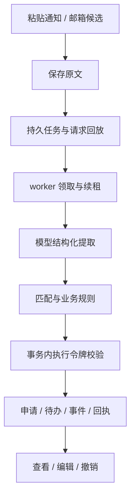

# 架构与代码入口

用户粘贴通知后，API 保存原文，用短事务建立幂等请求和任务，返回202。worker取得租约与执行令牌，调用模型提取字段、证据及日期，再由服务完成公司/岗位匹配和业务写入。申请、事项、事件、回执和任务完成状态在受控事务中提交。默认自动保存，缺岗位或没有待办也可记录，真正歧义留待整理。

| 代码入口 | 职责 |
| --- | --- |
| `api/`、`schemas/` | API、鉴权、归属、请求和响应契约 |
| `services/automatic.py` | 默认匹配保存流程、未解决状态、版本保护与撤销 |
| `agent/notification_extractor.py` | 模型结构化提取和结果校验 |
| `services/sessions.py` | 多轮Agent及工具能力；旧方案确认接口保留作兼容协议 |
| `services/jobs.py`、`worker.py`、`job_execution.py` | 入队/回放、租约、尝试历史、取消/重试、事务令牌隔离 |
| `mail_transport.py`、`mailboxes.py`、`mail_scheduler.py`（均在 services 下） | IMAP只读接入、缓存/游标、独立同步和候选入队 |
| `database/` | 连接预算、增量迁移、种子与回读 |
| `core/observation.py`、`services/runtime_observation.py`、`api/operations.py` | 请求编号、心跳、指标、追踪和告警状态 |
| `web/` | React / TypeScript工作台与生成API类型 |
| `scripts/data_recovery.py` | 归档、校验、新库恢复、暂停与显式启用 |
| `scripts/check_release.py` | 从源码包解压构建的本地发布检查 |

## 关键决策

持久队列使用PostgreSQL，减少独立基础设施。API、worker和scheduler分进程、分连接池，模型等待不占用API事务连接。队列和执行槽位有限，超限返回429；请求重试保留原编号，可回放已有任务。

租约过期后可接管，旧worker提交必须在事务内再次校验执行令牌，防止迟到写入。数据库业务可去重；外部模型已收到请求但返回未知时，仍不能保证远端调用恰好一次。重试次数、单次执行和整体期限都有限。

邮箱调度不依赖Web进程生命周期。先保存邮件缓存、UID/UIDVALIDITY和游标，再为招聘候选入队；同账户同步任务通过数据库去重。默认每12小时读取、首次60天，不发送邮件。

主动编辑带version，写操作带request_id。撤销检查记录版本，保护之后的手动修改。数据库是业务事实来源；日志/心跳只服务排障，不代替回执。日期不强制到时分，默认类别“27秋招/实习”与已投递/测评/笔试/面试等进度分开。

当前仍是个人空间。虽然数据和任务有归属约束，尚未开放多用户注册。恢复副本默认暂停业务写入和后台执行；密钥与数据库分开保管，详见[恢复说明](backup-restore.md)。
