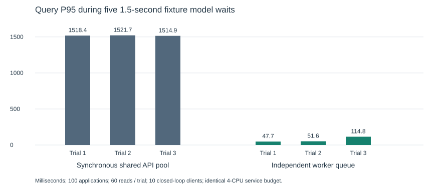

# 验证与适用边界

日期：2026-10-29。公开摘要位于[evidence](evidence/)。原始本机日志和私人运行目录不随仓库上传；可以用仓库内脚本在新的隔离环境复测。摘要只记录检查项、条件和结果，不是生产SLA或独立第三方认证。

## 功能与故障恢复

| 检查 | 通过项 | 实际覆盖 |
| --- | ---: | --- |
| 本地发布 | 20 | 新目录解压构建、四服务健康/资源设置、登录、202入队、自动保存、回放、重启、撤销、手动修改保护、停机与恢复 |
| 可靠性 | 46 | PG/HTTP/进程故障、租约接管、迟到写入隔离、取消重试、邮箱替身等 |
| 迁移与边界 | 11 | 旧数据升级至0014、幂等、429和默认同步入口限制 |
| 运行观测 | 31 | 请求/任务/尝试追踪、心跳、健康、告警状态和日志脱敏 |
| 自动保存 | 25 | 默认无需确认、缺字段、匹配、纠错、撤销及邮箱候选 |
| 独立备份恢复专项 | 29 | 删除合成源库后恢复新库，13表指纹一致，密钥/暂停/激活/迁移失败 |

发布验收使用真实容器、PostgreSQL、API与worker。模型是预置提取或明确延迟替身；邮箱是合成协议替身或未绑定账户，没有通过检查调用真实模型/IMAP。常规verify只核查表数量/约束/迁移/密钥；13表逐行内容指纹是恢复演练另做的核对。

优雅停机测试在worker执行6秒替身时提交另一任务，再运行正式stop入口，确认在途完成、排队保留。强停测试将容器等待缩短到1秒，确认退出137，之后旧attempt为expired、新attempt为succeeded，业务回执唯一。它验证恢复协议，不代表实际默认150秒期限都被等待一遍。

## 性能实验

合成数据：5000申请、10000事项、30000事件、50000通知、50000历史任务、10000提取。主机Apple M4、10逻辑CPU、16GiB内存，Docker Linux aarch64；API1CPU/512MiB、两worker各0.5CPU/512MiB、PG2CPU/1GiB，总4CPU/2.5GiB，负载生成器在该预算之外。后续delivery默认预算不同，不混用实验结论。

正常查询10/30/100请求每秒，每档30秒、3轮，共25,200次测量请求均200。这不是最大饱和容量测试，也不等于100个并发模型调用。

隔离控制实验用100申请、5个1.5秒模型等待和10并发查询：同步路径P95约1518/1522/1515ms，独立worker队列约48/52/115ms。这是该条件下连接隔离的收益，不代表任意负载同比提升。

准入重复查询合并后，服务端三轮P95约59/59/79ms，客户端仍有410ms慢轮；后续6轮请求级诊断仍有约330ms慢轮，主要时间在应用连接等待，更底层原因未定位。200ms端到端目标尚未稳定达到。驱动和冻结条件见`evals/p11/load-contract.json`及`scripts/benchmark_p11*.py`，本次开源准备没有重跑性能实验。



## 模型评测

`evals/p9/`保留合成开发/留出材料和摘要。历史开发集从6/8修订至8/8；首次合成留出5/10。修订后已见样例不能重新称为未见测试。真实模型开发验证不等于真实用户流量准确率，也不能从结构校验通过推出业务正确率。

## 复测

```bash
python3 scripts/check_release.py --suite quick --output .work/check-quick
python3 scripts/check_release.py --suite full --output .work/check-full
```

quick会构建并进行20项发布验收；full另运行113项核心回归。输出目录必须是新目录，需要Docker。独立29项恢复演练可运行`scripts/check_p117_recovery.py`，按环境设置P117_IMAGE和P117_OUTPUT。不自动执行历史付费模型脚本或性能压测；真实模型验证需要使用者显式提供自己的凭据。
